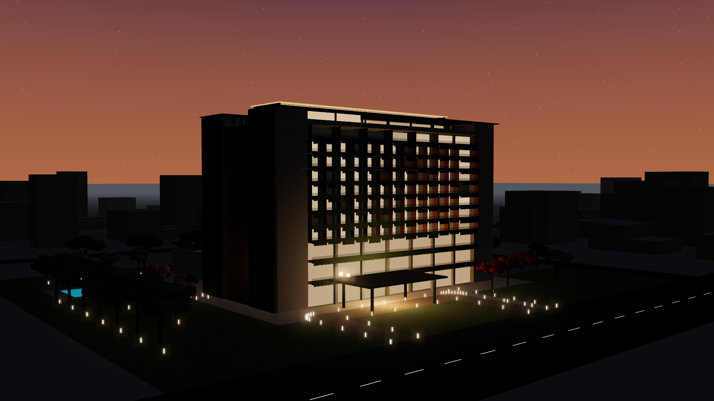
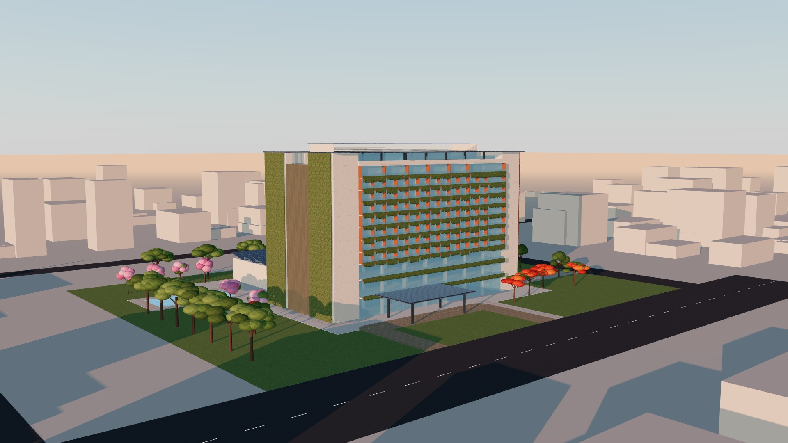
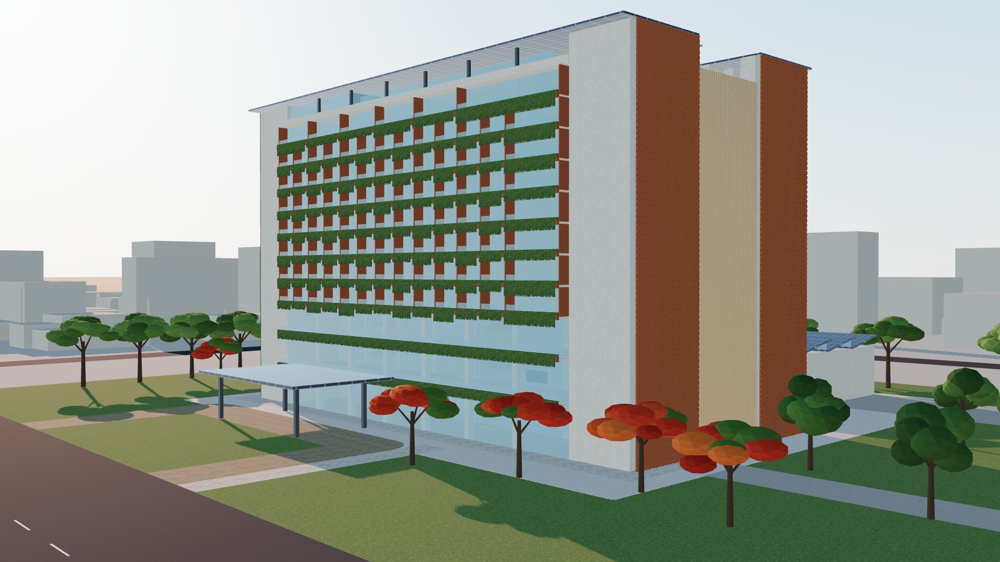
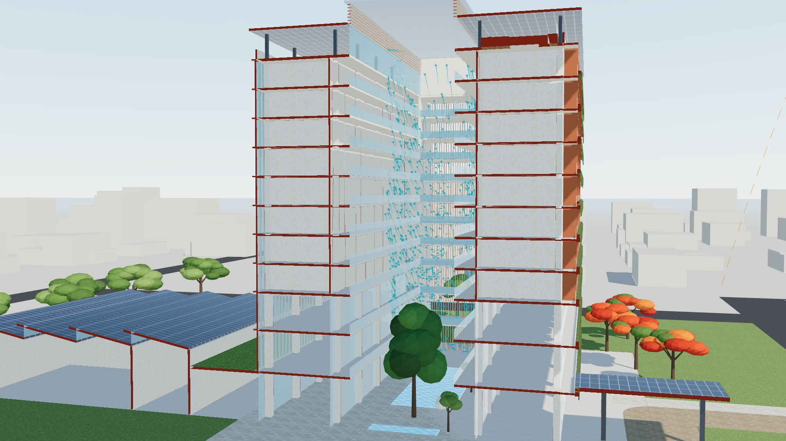
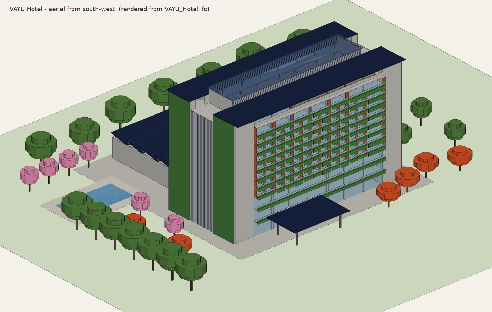
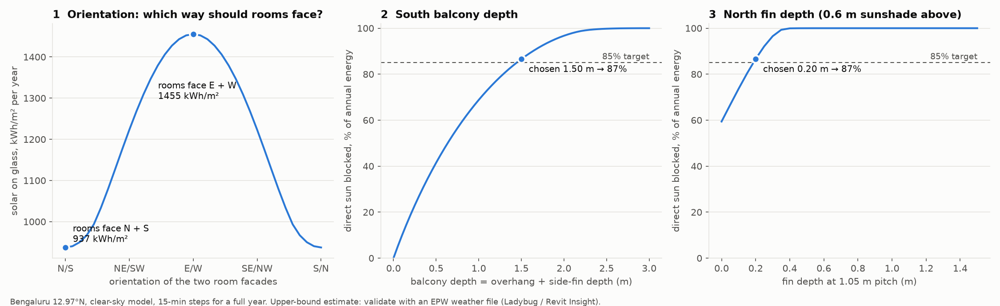
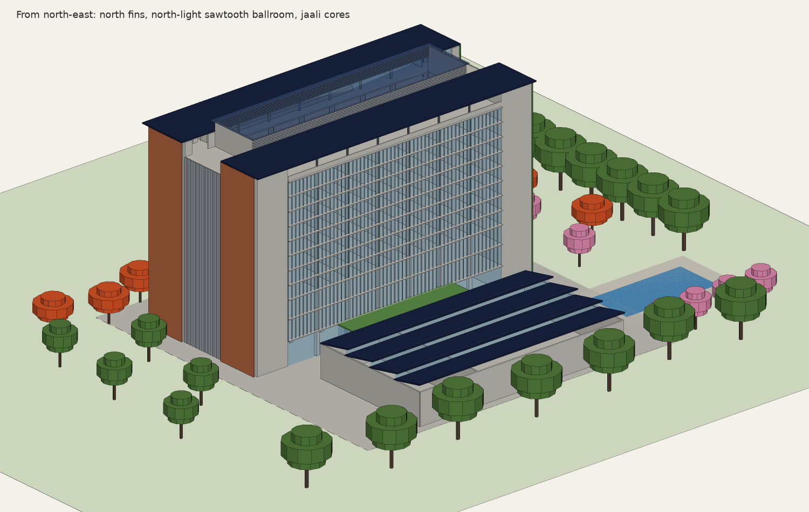
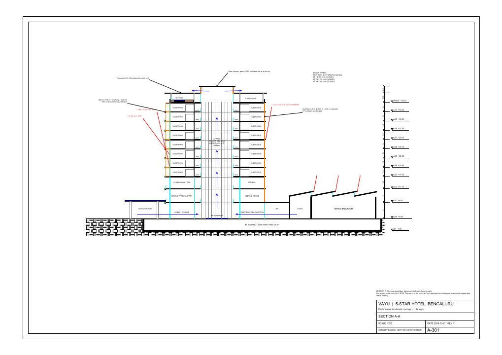
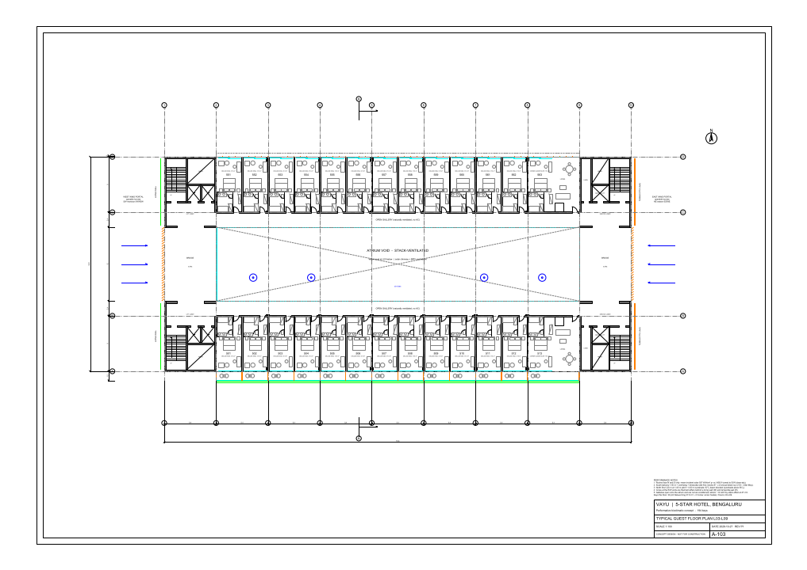

# VAYU: a 5-star hotel in Bengaluru, shaped by its performance

*Vayu* is Sanskrit for wind. This is a concept design for a 194-key, 5-star hotel. Its form was not drawn first and checked later. A solar and wind engine computed the orientation, every shading device and the PV tilt, and the model is generated from those results. Change a target and the building changes with it.



## See it in 3D

**[Open the interactive model](https://claude.ai/artifact/Y2ZZRDjAYaEH39PW8HUJVa)** (private until you share it). It is the same BIM geometry, running live in the browser:

- **Sun dial:** pick any date and time. The real sun position for 12.97°N moves the shadows, and the readouts give the share of guest-room glass in direct sun, solar output and the season's wind, from the same engine that sized the shading.
- **Seven chapters:** Orientation, Shade, Wind, Solar roof, Rain, Garden city, After dark. Each one flies the camera to the view that explains it.
- **Wind** streams through the portals and up the atrium; **Section** cuts the building on line A-A; **Rain** shows the monsoon; after sunset the rooms, atrium and solar chimney light up.
- **Tap any element** to read its IFC class, level, material and VAYU id.

| | |
|---|---|
|  |  |
| Golden hour, late November | From the road, under the gulmohar in May |
|  |  |
| Section A-A: December wind enters from the east and rises to the chimney | Check render made straight from `VAYU_Hotel.ifc` |

## What you can open

| File | Open with | What it is |
|---|---|---|
| `bim/VAYU_Hotel.ifc` | **Revit**: File › Open › IFC (or Insert › Link IFC). Also BIMvision, Solibri, BlenderBIM | Full BIM model, IFC4, 13 storeys, 1,630 elements (35 trees as `IfcGeographicElement`) + 194 room spaces, with materials, colours and a `VAYU_Performance` property set |
| `revit/build_vayu_hotel.py` + `revit/vayu_model.json` | **Revit 2022+** with pyRevit or RevitPythonShell | Builds the hotel as **native, editable** Revit levels, grids, walls, curtain walls, floors, columns and rooms |
| `cad/A-001 … A-301 *.dxf` | **AutoCAD**, BricsCAD, LibreCAD; Revit: Insert › Import CAD (metres) | 6-sheet drawing set with title blocks, dimensions and performance notes |
| `web/index.html` + `vayu-scene.json` | the link above, or `python3 src/serve_web.py` then http://localhost:8765 | The interactive 3D model (three.js) |
| `previews/*` | any viewer | Hero renders, plots of every sheet, IFC check renders, performance charts |
| `src/` | Python 3 | The engine. `src/build_all.py` regenerates everything |

**Revit, two routes:**
1. **Fast:** open the IFC. Geometry, levels and materials come in, but walls and floors arrive as IFC-imported (non-native) elements.
2. **Editable:** start a project from the *metric Architectural template*, optionally load `M_Concrete-Rectangular-Column`, keep `vayu_model.json` next to the script, and run `build_vayu_hotel.py` from pyRevit. It creates 13 levels with plan views, 14 grids, 1,104 walls in thickness-matched types, 86 curtain walls (glazing and glass balustrades), 43 floors with the atrium void, 288 structural columns, 194 numbered rooms, and DirectShapes for the fins, louvres, jaali, living wall, PV roofs, balcony gardens and trees (as Planting). Every element's *Comments* holds its VAYU id. The template's own *Level 1 / Level 2* stay; delete them afterwards.

## The concept: six moves

**Site:** Bengaluru, 12.97°N, 920 m altitude, on a 160 × 130 m (2.08 ha) urban plot with the main road to the south. The climate is warm and cooling-dominated all year. Winds blow from the W/WSW in the SW monsoon (May–Sep) and from the E/ENE in the NE season (Nov–Feb).



1. **Orientation, found by a sweep.** The two room facades were rotated through 180°. With rooms facing **north and south**, the glass receives **937 kWh/m²·yr**. Facing east and west, it receives **1,455 kWh/m²·yr** (+55%). So the 75.6 m slab runs east-west, and only the service cores face east and west.
2. **Shading sized to an 85% target, not drawn by taste.**
   - *South:* the balcony slab is the overhang and the terracotta dividers between balconies are the side fins. The smallest depth that blocks 85% of annual direct sun is 1.45 m, built as **1.50 m**. It blocks **87%** over the year and **100% in March–May**, the hottest months.
   - *North:* at 13°N the sun is in the **north sky from late April to mid-August**, so the north facade needs shading too. A 0.6 m sunshade alone blocks 59%. Adding **0.20 m fins at 1.05 m pitch** raises this to **87%** (91% in March–May).
   - *East and west:* the four cores are **thermal buffers**. The west cores sit behind a **living green wall** facing the afternoon sun; the east cores sit behind a **terracotta jaali**.
   - Result: solar heat gain through the 2,964 m² of guest-room glass is **385 MWh/yr**. The same building unshaded would get 694 MWh/yr (**−45%**). Turned to face east and west, it would get 1,078 MWh/yr (**−64%**).
3. **One atrium serves both winds.** The east-west axis that solves the sun also lines the 12 m atrium up with **both seasonal wind directions**. Operable louvred **wind portals** at each end and a shaded **water court** at grade pre-cool the incoming air. A **solar chimney** with a semi-transparent BIPV glass roof draws it upward. With a 46 m stack and 90 m² of effective opening, the airflow is ~132 m³/s (**~14 air changes per hour at a 2 K temperature difference**; 10 ACH at 1 K). The single-loaded galleries open onto the atrium and are **not air-conditioned**.
4. **A PV parasol over the whole roof.** A raised PV canopy at +46.25 shades the roof, the sky bar and the chiller plant. The ballroom has a **sawtooth roof**: PV on its south slopes at the **optimum 11° tilt** (found by a tilt sweep) and **north-light clerestories** under 1.10 m overhangs for glare-free daylight. **799 kWp ≈ 1,146 MWh/yr**, about **24%** of demand at a 200 kWh/m²·yr EUI target.
5. **Water.** 5,047 m² of roof catchment × 970 mm/yr gives **~4,160 m³/yr** of harvested rainwater. A **429 m³** tank in the basement holds a 100 mm storm.
6. **Garden city.** Bengaluru is known as the Garden City, and the planting follows its calendar. **Gulmohar** flowers flame red along the road in April–June, **pink tabebuia** lines the north lawn in February–March, **rain trees** shade the edges, neem screens the service side, and a **ficus** grows up through the atrium (35 trees in all). Every south balcony on L01–L10 has a **terracotta trough of bougainvillea** that trails 0.4–0.95 m over the edge. A **30 m sky pool** sits on a raised timber deck under the PV parasol, behind a glass balustrade. The troughs add a little shade and evaporative cooling; the shading figures above do not count them, so those figures stay conservative.



## Programme

| Level | Elev. | Use |
|---|---|---|
| ROOF | +42.70 | Sky bar, 30 m sky pool on a timber deck, and chiller plant under the PV parasol (+46.25); solar chimney to +48.7 |
| L10 | +39.30 | Suites floor: 10 Executive Suites, 2 Presidential Suites |
| L03–L09 | +15.50 … +35.90 | 26 keys per floor: 24 Deluxe King (37.8 m² + 6.3 m² balcony), 2 Corner Junior Suites |
| L02 | +11.00 | Spa, fitness, club lounge |
| L01 | +6.00 | Specialty restaurant, meeting rooms |
| L00 | ±0.00 | Lobby and lounge, reception, all-day dining (180 covers), lobby bar, water court, porte-cochère; ballroom wing (960 m², 1,000 theatre / 600 banquet, divisible in 3), banquet kitchen, loading |
| B1 | −4.50 | Parking (~220 cars), laundry, plant, staff, rainwater tank |

**Keys:** 194 (168 Deluxe King, 14 Corner Junior Suites, 10 Executive Suites, 2 Presidential Suites). **GFA:** 23,474 m² above ground + 7,744 m² basement. **FAR** 1.13, **ground coverage** 22.7%, **height** 42.7 m to roof. **Structure:** 8.4 m grid (two room bays); galleries cantilever 2.4 m into the atrium; four concrete cores take lateral loads.

## Drawing set

| Sheet | Scale / size | Shows |
|---|---|---|
| A-001 Site plan | 1:500 @ A1 | Setbacks, drop-off loop, service yard and ramp, gardens, wind arrows, sun-path diagram, site data |
| A-101 Ground floor | 1:200 @ A1 | Lobby, dining, water court, cores, ballroom wing, pool, porte-cochère, airflow |
| A-103 Typical guest floor | 1:100 @ A0 | Every key furnished, cores with stairs/lifts, galleries, fins, dimensions, performance notes |
| A-105 Roof plan | 1:200 @ A1 | PV module layout on every roof, solar chimney, rainwater, PV yield table |
| A-201 South elevation | 1:200 @ A1 | Balconies and fins, cores, parasol, chimney louvres, levels |
| A-301 Section A-A | 1:200 @ A1 | Sun angles at solar noon (21 Dec 53.6°, equinox 77.0°, 21 Jun 79.5° *from the north*), stack-effect airflow, sawtooth ballroom |




## Changing the design

All inputs are at the top of `src/performance.py` (site latitude, rainfall, PV yield, shading target, glass height, minimum balcony) and `src/model.py` (bay, room depth, atrium width, number of floors, floor heights). Then run:

```bash
python3 -m venv .venv && .venv/bin/pip install ezdxf ifcopenshell matplotlib numpy
.venv/bin/python src/build_all.py
```

It reruns the sweeps and rebuilds the model, IFC, DXF sheets, Revit data, charts, previews and the 3D scene data in about 15 seconds. To view the 3D page locally, run `python3 src/serve_web.py` and open http://localhost:8765. For another city, change `SITE` in `performance.py`: the orientation, balcony and fin depths, and PV tilt all re-derive.

## How this was checked, and what was not

- **IFC:** passes `ifcopenshell.validate` with 0 schema issues; the check renders are made from the IFC itself.
- **Revit script:** dry-run against a mocked Revit API that rejects what Revit would: curves under the short-curve tolerance, open or non-planar curve loops, non-positive extrusions or wall heights. Every one of the 1,630 elements and 194 rooms maps to exactly one call, with no failures. **It has not been run inside Revit.** Type duplication, family parameter names (`b`/`h`) and room placement depend on your template, so expect to adjust small things on the first run.
- **3D page:** tested in a local browser at desktop and phone sizes, in light and dark mode, with the same page wrapper the host adds. The published link needs a sign-in, so it was not opened from there. It needs WebGL and loads three.js from a CDN.
- **Solar numbers** use a clear-sky model (an upper bound that ignores monsoon cloud). The PV yield of 1,450 kWh/kWp·yr and the 970 mm rainfall are typical published values. The 200 kWh/m²·yr EUI is a **target I assumed**, not a simulation. Before design development, validate with an EPW weather file in **Ladybug/Honeybee or Revit Insight**, and confirm PV with PVWatts.
- **Not yet done:** structural and MEP design, fire egress and NBC 2016 / Bengaluru bye-law compliance (setbacks, FAR, high-rise fire NOC; NBC treats anything over 15 m as high-rise), parking count, kitchen and BOH planning, interiors.

*Concept design — not for construction.*
